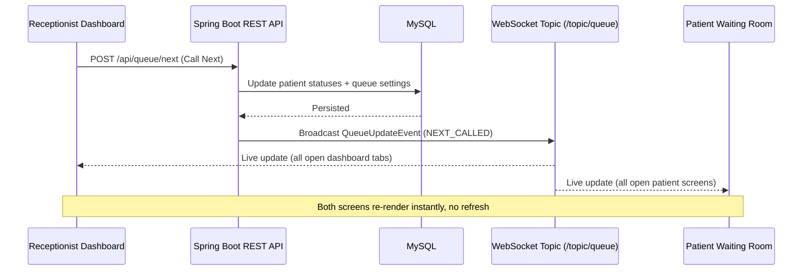

# Queue Cure — Socket Event Flow Diagram



## Event Types

| Event Type          | Triggered By                          |
|----------------------|-----------------------------------------|
| `PATIENT_ADDED`      | POST /api/patients                     |
| `PATIENT_REMOVED`    | DELETE /api/patients/{id}              |
| `NEXT_CALLED`        | POST /api/queue/next                   |
| `SETTINGS_UPDATED`   | PUT /api/settings/time                 |

## Payload Shape

```json
{
  "eventType": "NEXT_CALLED",
  "timestamp": "2026-06-19T10:15:00",
  "queueStatus": {
    "currentToken": 6,
    "currentPatientId": 21,
    "currentPatientName": "Priya Nair",
    "waitingCount": 9,
    "completedCount": 5,
    "averageConsultationTime": 10,
    "lastGeneratedToken": 20
  },
  "waitingPatients": [
    {
      "id": 22,
      "tokenNumber": 7,
      "patientName": "Vikram Rao",
      "status": "WAITING",
      "tokensAhead": 0,
      "estimatedWaitMinutes": 0
    }
  ]
}
```

Every connected client (any number of dashboard tabs and patient screens) receives the same broadcast, so the entire system stays in sync from a single source of truth in MySQL.
